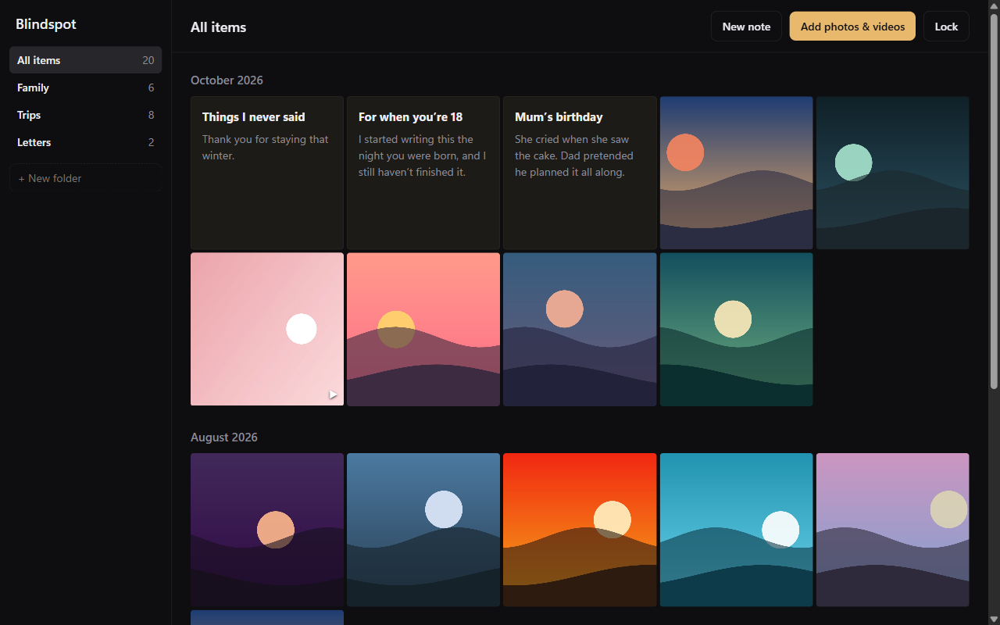

# Blindspot

**The one spot on your PC that AI can't see.**

A private locker for your photos, videos and notes on Windows. Anything you add disappears from File Explorer, Windows Search and the Photos app. It only exists, encrypted, inside Blindspot, and the Blindspot window is hidden from **AI agents, screenshots and screen shares**.

**[⬇ Download for Windows](https://github.com/Kadri-cloud/blindspot/releases/latest)**: unzip and run `Blindspot.exe`, no installer needed. See [Install and run](#install-and-run) for details.


<sub>Screenshot made with placeholder images and notes.</sub>

> **Status:** early, Windows only, **not security-audited**. Read the [threat model](#threat-model) before trusting it with anything. Blindspot was called *Locker* until v1.1; an existing locker is picked up automatically.

---

## The gap

Many people keep private photos, videos and notes on a laptop they also use for work or share with family. The everyday risk isn't a forensics lab. It's an accident:

- a private photo appears in Windows Search or the Start menu,
- File Explorer shows a thumbnail in "Recent" or "Quick access",
- you share your screen in a meeting while the wrong window is open,
- **an AI assistant or agent that can see your screen reads it.** Windows Recall takes snapshots of your screen. Agents like Claude's computer use, Microsoft's UFO² and Windows-MCP read apps through screenshots and through the accessibility layer that screen readers use.

Windows gives apps no way to opt out of AI agents. Signal [asked Microsoft for one](https://signal.org/blog/signal-doesnt-recall/) in 2025. A survey of what exists, in October 2026:

| Option | Examples | What's missing |
|---|---|---|
| Encrypted drives and folders | [VeraCrypt](https://veracrypt.io), [Cryptomator](https://cryptomator.org) | Strong encryption but no gallery. Once unlocked they appear as a normal drive, so Explorer makes thumbnails, Search and AI tools can index them, and [files can show up in Quick Access](https://community.cryptomator.org/t/files-can-be-seen-in-quick-access-windows/6713). |
| Folder hiders and lockers | Folder Lock, Wise Folder Hider | Closed source, so you can't check what they really do. Some only hide or lock files rather than encrypt them. |
| Self-hosted media vaults | [PersonalMediaVault](https://github.com/AgustinSRG/PersonalMediaVault), [CryptHaven](https://github.com/BrannonSD/CryptHaven) | Good projects, but they run a local server that you use through a web browser, and they don't hide from screen capture or AI agents. |
| Phone vault apps | [Wolf Gallery](https://github.com/Wolf-Project777/wolf-gallery), Stingle Photos, Photok | Built for phones, with no Windows desktop app. |
| Encrypted cloud photos | [Ente](https://ente.com) | Excellent end-to-end encryption, but it needs a cloud account. |

As far as we could find, **none of them hides its window from screen shares or AI agents**, and none is a small open-source Windows app you just open to see an encrypted gallery. That's the gap Blindspot fills.

## What Blindspot does

- **Invisible to AI agents.** AI agents read an app in three ways, and Blindspot blocks all three:
  - **Screenshots:** Recall, screenshot-based agents, screen shares and recordings see whatever is behind the window.
  - **The accessibility layer:** agents that read app text without pixels see an empty window.
  - **Debugging hooks:** the release build refuses to start in debug mode and ignores code-injection switches.
- **One password.** Nothing is visible until you unlock.
- **Add means move in.** Each photo or video is encrypted into the locker, checked, and only then deleted from where it was. Drag and drop works.
- **Gallery by month**, a full-screen viewer, and videos that play and seek normally.
- **Folders.** Create folders in the sidebar and drag items onto them.
- **Secret notes.** Write letters, diary entries or anything else next to your photos, encrypted like everything else.
- **Export** turns any item back into a normal file you can share.
- **Locks automatically** when you minimise it or lock Windows.
- **Offline.** No account, no cloud, no telemetry, no network calls.

## How it works

The app is about 650 lines. Its only runtime dependency is Electron; all encryption uses Node's built-in `crypto` module.

| | |
|---|---|
| **Storage** | `%APPDATA%\Blindspot\vault` holds a `salt`, an encrypted `index` (names, dates, types, folders and the text of your notes) and one file per item, named with 32 random hex characters and no extension. Windows and AI indexers have nothing to recognise, preview or read. |
| **Key** | scrypt (N=2¹⁷, r=8, p=1) from your password and a random 16-byte salt. The key exists only in memory while the locker is unlocked and is zeroed when it locks. |
| **Encryption** | AES-256-GCM in 1 MiB chunks. Each chunk has its own random 96-bit nonce, and its chunk number is bound in as associated data, so chunks can't be swapped around. Chunking lets a video seek without decrypting the whole file. |
| **Viewing** | A custom `vault://` protocol streams decrypted bytes straight into `` and `<video>`. No decrypted temporary files are ever written. |
| **Import** | Encrypt to a `.part` file, re-read and decrypt it, and compare the SHA-256 with the original. Only then is the original deleted. |
| **Screenshots** | `setContentProtection(true)`, which calls Windows' `SetWindowDisplayAffinity(WDA_EXCLUDEFROMCAPTURE)`. It's switched on before the window is first shown. Needs Windows 10 version 2004 or later. |
| **Accessibility layer** | Chromium's `disable-renderer-accessibility` switch, so UI Automation clients see only the window frame. |
| **Debugging hooks** | The release build exits if started with `--inspect` or `--remote-debugging-*`, DevTools are off, and the Electron [fuses](https://www.electronjs.org/docs/latest/tutorial/fuses) `RunAsNode`, `NODE_OPTIONS` and `--inspect` are switched off in the binary. |

The code is short enough to read in one sitting. Start with [`vault.js`](vault.js) and [`main.js`](main.js).

## Threat model

**Blindspot protects against**
- someone using or looking at your PC: File Explorer, Windows Search, the Photos app and thumbnails of anything you've imported;
- screen sharing, screen recording, screenshots and Windows Recall;
- AI agents that read your screen through screenshots or the accessibility layer, and automation tools that attach through debugging hooks;
- someone who copies the vault folder but doesn't know your password (provided the password is strong).

**Blindspot does not protect against**
- **An AI agent or program that can run code as you while Blindspot is unlocked.** It can get around anything an app can do. Lock Blindspot before giving an agent control of your PC.
- **Remote Desktop.** The window still shows in an RDP session.
- **Phone cameras.** If your eyes can see the screen, a camera in the same spot can too.
- **Traces from before you imported.** Windows may already have thumbnails cached, Recent-files entries, Recycle Bin copies, or cloud backups of the originals. After your first import, run *Disk Cleanup → Thumbnails* and check your cloud sync.
- **Recovery of deleted originals** from the disk, especially on SSDs. Turn on BitLocker or Device Encryption for full-disk coverage.
- **Malware, keyloggers**, or kernel-level screen capture.
- **Forgetting your password.** There is no recovery, by design.
- **Hiding that Blindspot exists.** The app itself is visible; only what's inside is private.

Microsoft describes the screen-capture flag as [best-effort, not a security boundary](https://learn.microsoft.com/en-us/windows/win32/api/winuser/nf-winuser-setwindowdisplayaffinity). **No independent security review has happened yet.** Reviews are very welcome.

## Install and run

**Download:** get `Blindspot-win-x64.zip` from the [latest release](https://github.com/Kadri-cloud/blindspot/releases/latest), unzip it anywhere, and run `Blindspot.exe`. To keep it handy, right-click `Blindspot.exe` and choose *Pin to Start*.

The app isn't code-signed yet, so Windows SmartScreen may say *"Windows protected your PC"*. Click *More info → Run anyway*. If you'd rather not trust a download, build it yourself from source.

**From source** (needs [Node.js](https://nodejs.org) 20 or later):

```bash
git clone https://github.com/Kadri-cloud/blindspot.git
cd blindspot
npm install
npm start          # run from source (debugging stays possible for development)
npm test           # encryption self-check
npm run build      # makes dist/Blindspot-win32-x64/Blindspot.exe with debugging locked
```

**Back up** by copying `%APPDATA%\Blindspot\vault` somewhere safe (or `%APPDATA%\Locker\vault` if you started with Locker). It's unreadable without your password.
**Uninstall** by deleting the app folder. Your locker stays in `%APPDATA%` until you delete it too, so export anything you want to keep first.

## Known limitations

- **Screen readers can't read Blindspot.** They use the same accessibility layer that AI agents read, so it's switched off. If you need a screen reader, please open an issue.
- iPhone HEIC/HEIF photos are stored safely but can't be previewed. Use Export to open them.
- The gallery loads full-size files rather than thumbnails, so it may slow down with thousands of items.
- There's no way to change the password yet, and there's one locker per Windows user.
- Folders are one level deep and can't be renamed yet. Notes are plain text.
- Tested only on Windows 11. Copilot Vision and Click to Do haven't been tested yet (they need a Copilot+ PC).
- Locking when Windows locks (Win+L) hasn't been tested yet. Locking on minimise has.

## Contributing

**Pull requests are welcome from anyone.** New features, fixes, tests, docs, translations. See [CONTRIBUTING.md](CONTRIBUTING.md) for how to start and the ideas we'd love help with.

**Corrections are as welcome as code.** The survey above is one person's snapshot from October 2026. If we got something wrong (an app that already does this, a project described unfairly, a flaw in the threat model or the encryption), open an [issue](https://github.com/Kadri-cloud/blindspot/issues) or a pull request.

For **security problems**, please report privately through the repository's *Security → Report a vulnerability* page rather than a public issue.

## License

[Apache 2.0](LICENSE)
